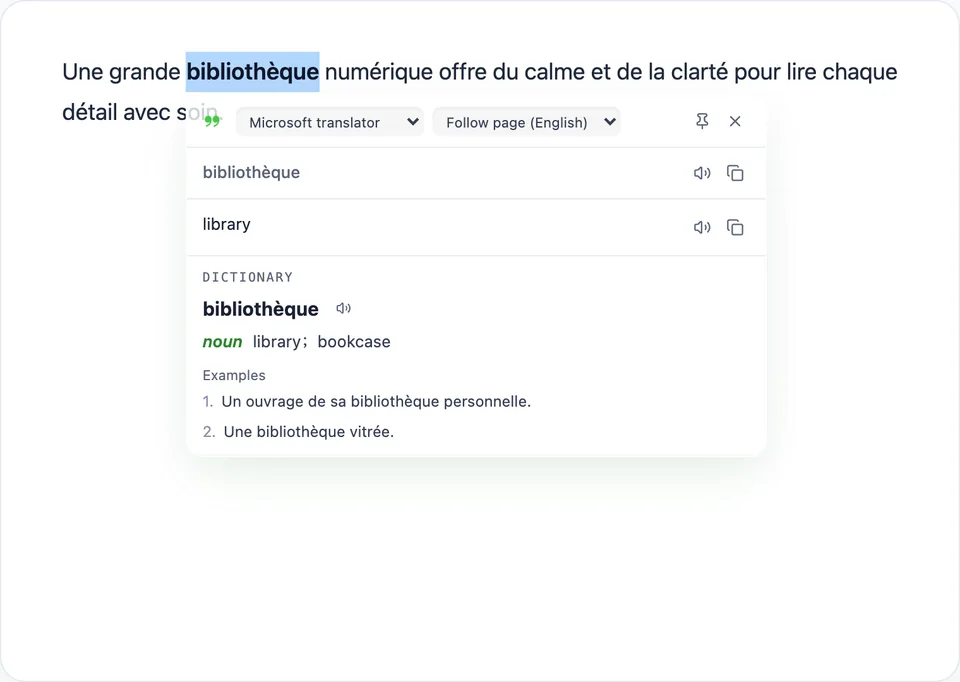
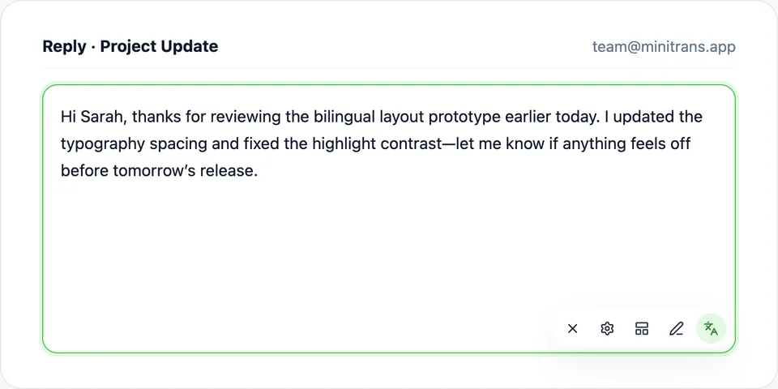

  

<h1 align="center">Mini Trans</h1>

  A free AI translation &amp; writing assistant for Safari, Chrome, Edge and Firefox. 
  Bilingual web pages, selection translation, AI writing and YouTube bilingual subtitles — right where you read.

  <a href="https://minitrans.app/en/">Website</a> ·
  <a href="https://github.com/XideaDev/MiniTrans.app/releases">Download</a> ·
  <a href="https://minitrans.app/en/help/what-is-mini-trans/">Help center</a> ·
  <a href="https://minitrans.app/en/support/">Support</a>
   
  <a href="README.zh-CN.md">简体中文</a> | English

  

## Download

| Platform | How to get it |
| --- | --- |
| **Safari on macOS** | Download the latest `MiniTrans-<version>-safari.dmg` from [Releases](https://github.com/XideaDev/MiniTrans.app/releases). Mac App Store listing coming soon. |
| Chrome / Edge / Firefox | Store listings coming soon. |

**Requirements (Safari):** macOS 15 or later with Safari 18.4 or later.

### Enable the Safari extension

1. Open the `.dmg` and drag **Mini Trans for Safari** into **Applications**, then launch it once.
2. Open **Safari → Settings → Extensions** and check **Mini Trans**.
3. Set website access to **Allow on Every Website** — the extension rewrites pages in place, so it needs access to the sites you read.
4. Keyboard shortcuts can be changed in Safari → Settings → Extensions (Safari 26 and later).

## Features

<table>
  <tr>
    <td width="50%"></td>
    <td width="50%"></td>
  </tr>
  <tr>
    <td align="center">Selection translation with dictionary &amp; TTS</td>
    <td align="center">AI writing inside any input box</td>
  </tr>
</table>

- **Web page translation** — bilingual or translation-only view, sentence-by-sentence highlighting of original and translation, translation styles, and per-site rules (translate areas, skip areas, custom CSS, rule subscriptions).
- **Selection translation** — dictionary, phonetics, examples and text-to-speech; compare several translation services side by side or switch to a compact card.
- **Input box &amp; paragraph translation** — translate what you type, or translate / restore the paragraph under the pointer.
- **AI writing** — grammar fixes, polishing and translation from a toolbar next to any input box, plus a two-column AI writing workbench.
- **YouTube bilingual subtitles** — hover a word to look it up, subtitle styles, AI sentence segmentation and subtitle download.
- **Your choice of services** — Microsoft, Google, Yandex, DeepL, Azure, Google Cloud, Baidu and the browser's built-in AI (Chrome / Edge); AI providers OpenAI, DeepSeek, Alibaba Cloud Bailian, Gemini, OpenRouter, Claude, Ollama or any compatible endpoint (bring your own API key where required).
- **Sync &amp; backup** — WebDAV and Google Drive (not available in Safari), automatic sync, and JSON import / export.
- **Shortcuts &amp; customization** — `Alt+S` translate page, `Alt+A` selection / input translation, `Alt+Q` paragraph, `Alt+W` AI workbench, double-tap `Ctrl` / `Alt`, custom single-press / hold / multi-press gestures, a floating ball, and customizable popups.

## Privacy

Mini Trans contains no analytics or telemetry and runs no servers that store your data. Settings and API keys stay in your browser; text is sent only to the translation or AI service you choose. Read the full [privacy policy](https://minitrans.app/en/privacy/).

## Feedback

- Bug reports and feature requests: [open an issue](https://github.com/XideaDev/MiniTrans.app/issues/new/choose). Please never paste API keys or personal data into a public issue.
- Email: [support@minitrans.app](mailto:support@minitrans.app)

## About this repository

This repository hosts Mini Trans documentation, release builds (DMG) and the public issue tracker. Mini Trans is free to use; its source code is not published here.

© 2026 Mini Trans. All rights reserved. See the [terms of use](https://minitrans.app/en/terms/).
