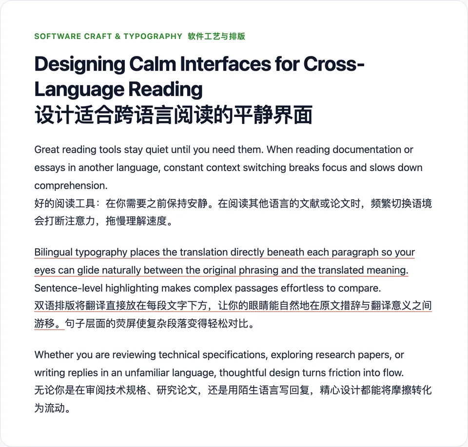
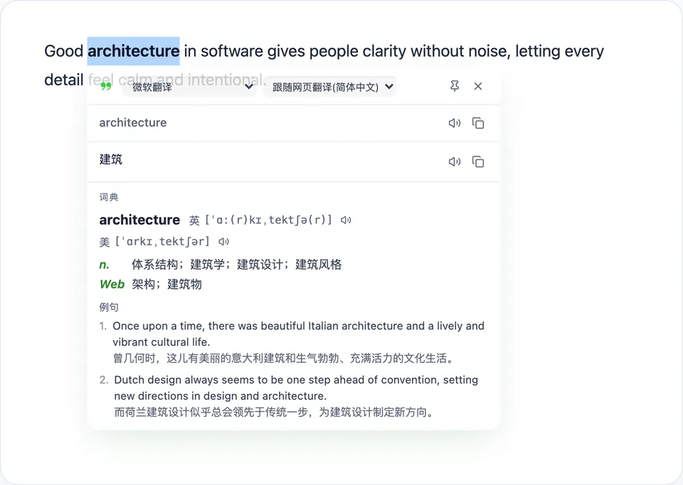
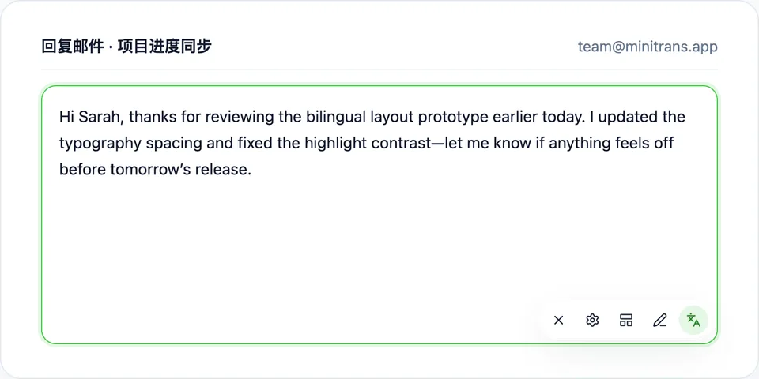

  

<h1 align="center">Mini Trans</h1>

  免费的 AI 翻译与写作助手，支持 Safari、Chrome、Edge 与 Firefox。 
  网页双语翻译、划词翻译、AI 写作与 YouTube 双语字幕，就在你正在阅读的页面里完成。

  <a href="https://minitrans.app/">官网</a> ·
  <a href="https://github.com/XideaDev/MiniTrans.app/releases/latest">下载</a> ·
  <a href="https://minitrans.app/help/what-is-mini-trans/">帮助中心</a> ·
  <a href="https://minitrans.app/support/">技术支持</a>
   
  简体中文 | <a href="README.md">English</a>

  

## 下载

| 平台 | 获取方式 |
| --- | --- |
| **macOS 上的 Safari** | 在 [Releases](https://github.com/XideaDev/MiniTrans.app/releases/latest) 下载最新的 `MiniTrans-<版本>-safari.dmg`。Mac App Store 版即将上线。 |
| Chrome / Edge / Firefox | 商店版即将上线。 |

**系统要求（Safari）：** macOS 15 及以上，Safari 18.4 及以上。

### 启用 Safari 扩展

1. 打开 `.dmg`，把 **Mini Trans for Safari** 拖进「应用程序」，然后启动一次。
2. 打开 **Safari → 设置 → 扩展**，勾选 **Mini Trans**。
3. 把网站访问权限设为 **「在所有网站上允许」**——扩展需要在页面上原地改写内容，所以要能访问你浏览的网站。
4. 从 Safari 26 起，可以在 Safari → 设置 → 扩展 中修改快捷键。

## 功能

<table>
  <tr>
    <td width="50%"></td>
    <td width="50%"></td>
  </tr>
  <tr>
    <td align="center">划词翻译：词典、例句与朗读</td>
    <td align="center">在任意输入框里使用 AI 写作</td>
  </tr>
</table>

- **网页翻译**：双语对照或仅译文，原文译文逐句对照高亮，译文样式，以及按网站设置的翻译规则（翻译区域、不翻译区域、自定义 CSS、规则订阅）。
- **划词翻译**：词典、音标、例句与语音朗读（TTS）；可多服务并排对照，也可切换为精简卡片。
- **输入框与段落翻译**：直接翻译你输入的文字，或翻译 / 还原鼠标所在的段落。
- **AI 写作**：在输入框旁的工具栏里完成语法纠错、润色和翻译，另有双栏 AI 写作工作台。
- **YouTube 双语字幕**：悬停查词、字幕样式、AI 分句与字幕下载。
- **服务自由选择**：微软、谷歌、Yandex、DeepL、Azure、Google Cloud、百度以及浏览器内置 AI（Chrome / Edge）；AI 服务支持 OpenAI、DeepSeek、阿里云百炼、Gemini、OpenRouter、Claude、Ollama 或任意兼容接口（需要时自备 API Key）。
- **同步与备份**：WebDAV 与 Google Drive（Safari 版不支持 Google Drive）、自动同步，以及 JSON 导入导出。
- **快捷键与定制**：`Alt+S` 翻译页面、`Alt+A` 划词 / 输入框翻译、`Alt+Q` 段落翻译、`Alt+W` 打开 AI 写作工作台，双击 `Ctrl` / `Alt`，自定义单击 / 长按 / 连击手势，悬浮球，以及可定制的弹窗界面。

## 隐私

Mini Trans 不含任何统计或遥测代码，也不运营存放用户数据的服务器。设置和 API Key 保存在你的浏览器本地，文本只会发送给你自己选择的翻译或 AI 服务。详见[隐私政策](https://minitrans.app/privacy/)。

## 反馈

- 问题反馈与功能建议：[提交 Issue](https://github.com/XideaDev/MiniTrans.app/issues/new/choose)。请勿在公开 Issue 中粘贴 API Key 或个人信息。
- 邮件：[support@minitrans.app](mailto:support@minitrans.app)

## 关于本仓库

本仓库用于存放 Mini Trans 的介绍文档、正式发布的安装包（DMG）和公开的问题反馈。Mini Trans 免费使用，源代码不在此公开。

© 2026 Mini Trans 保留所有权利。详见[使用条款](https://minitrans.app/terms/)。
